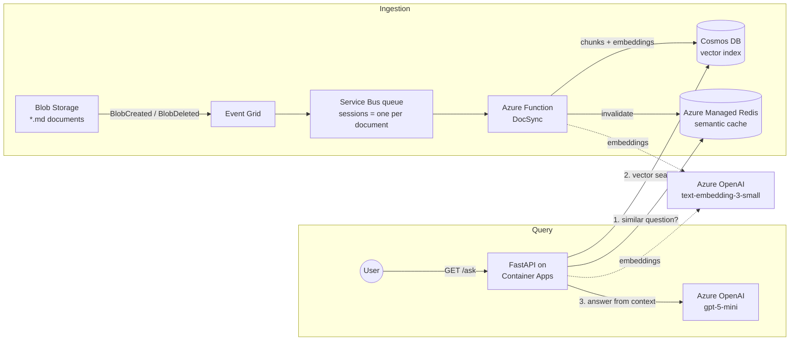

# RAG Lab on Azure

A small but complete **Retrieval-Augmented Generation (RAG)** system built on Azure with Python.

You drop Markdown documents into a storage container, and they are automatically split into chunks, turned into embeddings and indexed. You can then ask questions over HTTP, and an LLM answers **using only those documents**. Repeated questions are answered from a semantic cache, so they come back fast and don't cost another LLM call.

The goal of the project was to build the kind of plumbing a real RAG service needs, beyond the "call the LLM" part: event-driven ingestion, keeping the index in sync when documents change or get deleted, caching, observability and, above all, **no secrets anywhere**. Every service authenticates with managed identities and Microsoft Entra ID.

## Architecture

There are two independent flows: one keeps the index up to date, the other answers questions.



Configuration lives in **App Configuration**, and the one real secret (the Application Insights connection string) is stored in **Key Vault** and referenced from App Configuration. Both apps receive only the App Configuration endpoint as an environment variable and load everything else from there at startup.

## How it works

### Ingestion: from a file to searchable chunks

1. **A document is uploaded** (or overwritten, or deleted) in Blob Storage.
2. **Event Grid** notices and publishes a `BlobCreated` or `BlobDeleted` event to a **Service Bus queue**.
3. The **DocSync** Azure Function picks up the message and:
   - downloads the document;
   - **splits it into chunks** of at most 256 tokens. It tries to keep whole paragraphs together and repeats about 40 tokens between consecutive chunks, so a sentence cut at a boundary still has its context ([`functions/chunking.py`](functions/chunking.py));
   - computes an **embedding** for every chunk with one batched call to Azure OpenAI;
   - writes the chunks to **Cosmos DB**, which has a DiskANN vector index on the embedding field;
   - removes leftover chunks if the new version of the document is shorter than the old one;
   - writes a small **header** item recording which version of the document is indexed;
   - **invalidates the cached answers** that were based on this document.

A deleted blob follows the same path, but removes all the document's chunks instead.

### Query: answering a question

The `/ask` endpoint ([`app.py`](app.py)):

1. **Embeds the question.**
2. **Checks the semantic cache** in Redis. If a *similar* question (not necessarily identical) was answered before, it returns that answer right away.
3. Otherwise it runs a **vector search** in Cosmos DB and takes the 3 chunks closest to the question.
4. It sends those chunks to the chat model with a strict instruction: *answer only from the provided context*.
5. It **stores the answer in the cache**, tagged with the IDs of the documents it came from, so that DocSync knows which entries to drop when one of those documents changes.

Each step is wrapped in an **OpenTelemetry** span and exported to Application Insights. Every request shows up as a trace with the cache check, the vector search and the LLM call as separate, timed steps.

## Design decisions worth explaining

**Events can arrive twice or out of order, and that has to be safe.**
Event Grid guarantees *at-least-once* delivery: the same event can be delivered more than once, and two quick updates to the same file are not guaranteed to arrive in order. Every blob event carries a `sequencer`, a value that increases with every change to that blob. DocSync stores the last processed sequencer in the document's header and ignores any event that is not newer. Duplicates and late events become harmless no-ops.

**One document at a time, many documents in parallel.**
The Service Bus queue uses **sessions**, and the session ID is the blob URL. Messages about the same document are therefore handled one after another by one function instance, while different documents are processed in parallel (up to 4 at a time, see [`functions/host.json`](functions/host.json)). Without this, two updates to the same file could race and interleave their writes.

**Overwriting is idempotent.**
Chunk IDs are deterministic (`<document>_<index>`), so re-indexing a document overwrites its chunks in place instead of duplicating them. Only the chunks past the new end of the document need to be deleted.

**The cache must never serve answers about a document that changed.**
Each cached answer is tagged with its source documents. When a document changes, DocSync deletes every cached answer that used it. It does this both *before* and *after* rewriting the chunks: the first pass stops stale answers from being served during the update, and the second removes any answer that a concurrent request may have built from the old chunks and cached in the meantime.

**No keys, no connection strings, no passwords.**
- Every compute resource (Container App, Function App, Event Grid topic) uses a **system-assigned managed identity**.
- Local (key-based) authentication is **disabled** on App Configuration and Redis.
- Roles follow **least privilege** ([`scripts/rbac.sh`](scripts/rbac.sh)): the query API can only *read* Cosmos DB, the ingestion function can *write* it, and only the API can pull images from the container registry.
- Cosmos DB and Redis don't use regular Azure RBAC for data access. Each has its own role system, which the script also configures.

## About the corpus: the "facts" are made up on purpose

The documents in [`corpus/`](corpus/) start with real, correct descriptions of Azure services, followed by a paragraph of **deliberately invented features**. Examples are the "Aurora" Service Bus tier, the "Vault Sentinel" Key Vault add-on and the "Cascade" scheduling mode in Container Apps. **None of these exist.**

They are there to test **grounding**. The model can't know these "facts" from its training data, so it can only answer questions like *"How many concurrent sessions does the Aurora tier support?"* by actually retrieving the right chunk. A correct answer (4,096) proves that retrieval works and that the model uses the context. An "I don't know" or an invented number points to a problem in the retrieval step.

## Project layout

```
app.py, config.py, embed.py   Query API (FastAPI), deployed to Container Apps
watch_changes.py              Dev tool: tails the Cosmos DB change feed live
Dockerfile                    Image for the query API
functions/                    DocSync ingestion function (Azure Functions, Python)
  chunking.py                 Paragraph-aware chunking (pure, no Azure dependency)
  db.py                       Cosmos DB reads and writes
  tests/                      Unit tests
corpus/                       Sample documents (see above)
scripts/                      Azure CLI scripts: provision, permissions, config, release
```

## Running it

You need the [Azure CLI](https://learn.microsoft.com/cli/azure/install-azure-cli) (logged in with `az login`), [Azure Functions Core Tools](https://learn.microsoft.com/azure/azure-functions/functions-run-local), and an Azure subscription where you can create resources and assign roles.

Each script is **idempotent**: if a step fails halfway, fix the cause and run the script again. Existing resources are detected and skipped.

```bash
export SUBSCRIPTION_ID=<your-subscription-id>
export SUFFIX=1234            # makes the global resource names unique to you

./scripts/provision.sh        # create every Azure resource
./scripts/rbac.sh             # grant roles to you and to the managed identities
./scripts/config.sh           # fill App Configuration and Key Vault
./scripts/release.sh          # build the image in ACR, deploy the API and the function
./scripts/upload_corpus.sh    # upload corpus/*.md, which triggers ingestion
```

`release.sh` prints the public URL at the end. Then try:

```bash
curl "https://<your-app>.azurecontainerapps.io/ask?question=What+does+Vault+Sentinel+do?"
```

Ask the same question twice: the second response has `"cached": true`.

Two optional tools help you watch the pipeline while it runs: `scripts/watch_queue.sh` shows the queue draining, and `python watch_changes.py` prints every chunk as it is written to Cosmos DB.

When you're done, **delete everything** to stop paying for it:

```bash
./scripts/teardown.sh
```

## Local development

`requirements.txt` lists only what the API needs at runtime, which is what goes into the Docker image. Development tools (the `ruff` linter and formatter, the `pyright` type checker, `pytest`) live in `requirements-dev.txt`, which includes the runtime file:

```bash
python -m venv .venv && source .venv/bin/activate
pip install -r requirements-dev.txt
ruff check . && ruff format --check . && pyright
```

The ingestion function has its own `functions/requirements.txt`, because it is deployed separately and Azure installs its packages during the remote build.

## Tests

The ingestion logic is covered by unit tests that run locally, with no Azure resources. Azure calls are replaced by fakes that record what they were asked to do.

```bash
cd functions
python -m venv .venv && source .venv/bin/activate
pip install -r requirements.txt pytest
python -m pytest tests
```

They check that:
- chunks never exceed the token budget, overlap correctly, and stay in document order;
- created and deleted documents go through the right steps in the right order, including the cache invalidation before and after the write;
- duplicate and out-of-order events are ignored.

## Known limitations

This is a learning project, and some things are deliberately left out:

- **The `/ask` endpoint has no authentication.** Anyone who knows the URL can spend your Azure OpenAI quota. A real deployment would add Entra ID auth (for example Container Apps' built-in authentication) or put the API behind API Management.
- **The infrastructure is defined in Azure CLI scripts, not Bicep or Terraform.** The scripts make every step explicit and easy to follow, but a declarative template would be the better fit for production.
- **Cache invalidation narrows the race window but doesn't fully close it.** A query that reads the old chunks and only finishes *after* the second invalidation could still cache a stale answer. Adding a TTL to cache entries would put an upper limit on how long such an answer can live.
- **Only Markdown and plain text** are supported. PDFs or Word files would need a text extraction step (for example Azure AI Document Intelligence) before chunking.
